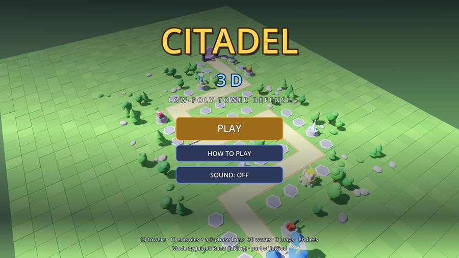
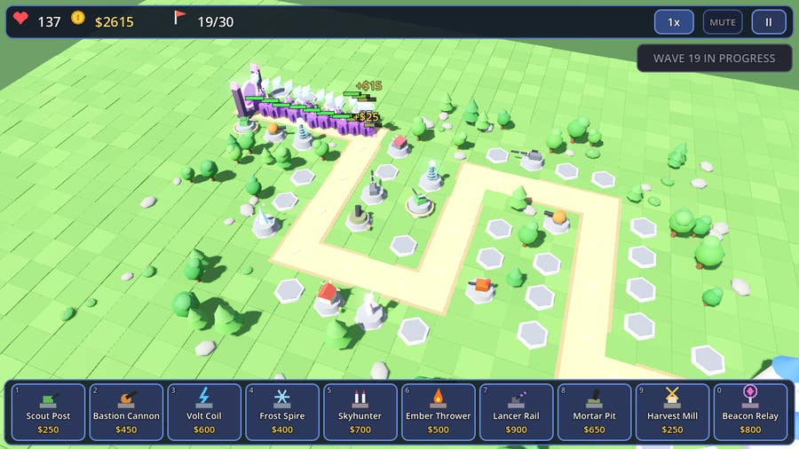
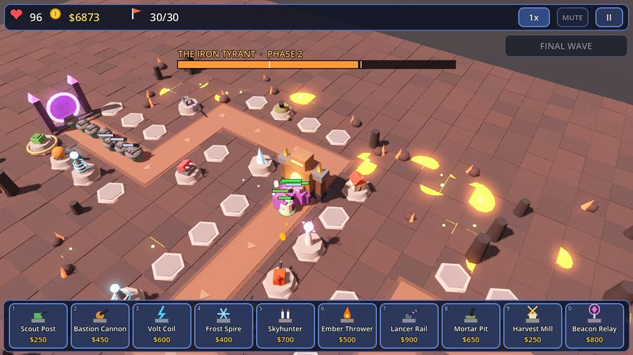
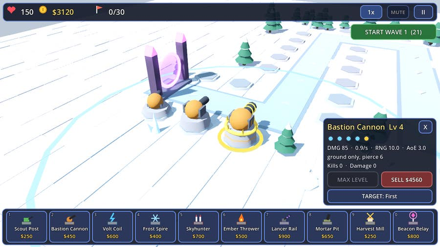
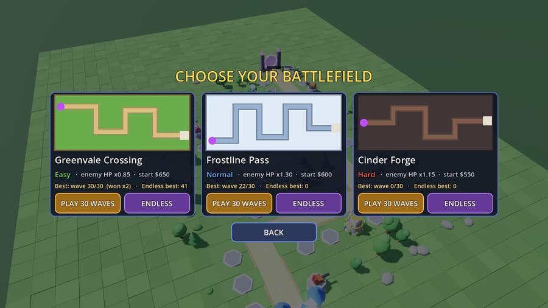
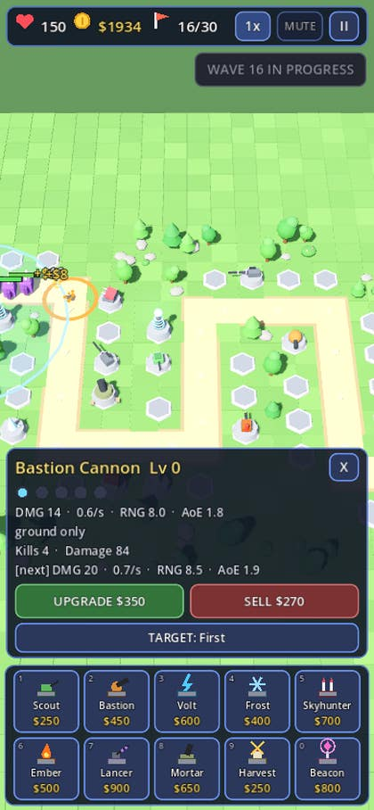

<div align="center">

# 🏰 CITADEL 3D 🏰

**An original low-poly 3D tower defense made in Godot 4.**
Build towers on glowing pads, upgrade each one four times, balance farms against firepower and survive 30 waves ending with the three-phase **Iron Tyrant**.

[](https://jaigod.github.io/citadel-3d/play/)

[](https://jaigod.github.io/citadel-3d/)
[](https://godotengine.org)
[](project.godot)
[](https://github.com/JaiGod/citadel-3d/actions/workflows/pages.yml)
[](LICENSE)



</div>

---

## 📸 Screenshots

| Mid-game battle | The Iron Tyrant (phase 2) |
|:--:|:--:|
|  |  |
| **Upgrades change the model** | **Three maps + endless** |
|  |  |

<p align="center"><b>Phone layout (390×844, touch)</b><br></p>

## 🔗 Links

- ▶ **Play:** <https://jaigod.github.io/citadel-3d/play/>
- 🌐 **Landing page:** <https://jaigod.github.io/citadel-3d/>
- 🧠 **Game code:** [`scripts/`](scripts) · 🧪 **Tests:** [`tests/`](tests) · 🌍 **Landing page source:** [`web/`](web) · ⚙️ **CI:** [`.github/workflows/pages.yml`](.github/workflows/pages.yml)
- 🏢 **JaiGod org:** <https://github.com/JaiGod>
- 🎮 **More JaiGod games:** [Bulwark TDS](https://github.com/JaiGod/bulwark-tds) (2D tower defense) · [Circuit Siege](https://github.com/JaiGod/circuit-siege) · [Iron Oath Tactics](https://github.com/JaiGod/iron-oath-tactics) · [Cloud Climb 3D](https://github.com/JaiGod/cloud-climb-3d) · [Stellar Barrage](https://github.com/JaiGod/stellar-barrage)

## ✨ Features

- 🎥 **Orbit / zoom / pan camera** over a real 3D map (mouse drag, right-drag, wheel; one finger, two fingers, pinch on touch; WASD/Q/E/Z/C on keyboard).
- 🗼 **10 original towers**, each with **4 upgrades that visibly change the model** (taller plinth, colored stripes per level, extra barrels/rings/pods, gold crown at max):

| # | Tower | Role | Notes |
|---|---|---|---|
| 1 | Scout Post | Rapid rifle | Cheap; sees stealth from level 2 |
| 2 | Bastion Cannon | Splash shells | Ground only; armor pierce from level 2 |
| 3 | Volt Coil | Chain lightning | Jumps between 3-7 enemies |
| 4 | Frost Spire | Area slow | Level 4 freezes enemies solid |
| 5 | Skyhunter | Homing missiles | 2x vs flyers, ½ vs ground; detects at lv3 |
| 6 | Ember Thrower | Fire stream | Burn damage over time; weak vs armor |
| 7 | Lancer Rail | Railgun sniper | Ignores armor, always sees stealth |
| 8 | Mortar Pit | Lobbed shells | Huge range and blast radius |
| 9 | Harvest Mill | **Farm** | Pays $50 → $750 at the start of every wave (max 6) |
| 0 | Beacon Relay | **Support** | +range / +fire rate (and dmg) aura; stealth sight at lv2 (max 3) |

- 🎯 **Targeting modes** per tower: First, Last, Strongest, Weakest, Closest.
- 👾 **10 enemy types**: Grunt, Dasher (fast), Brute (tough), Shellback (**armored**), Wisp (**flying**), Shade (**stealth**), Splitter (bursts into 3 Dashers), Mender (heals allies), Juggernaut (armored mini-boss), Stormwing (armored flyer).
- 💀 **The Iron Tyrant**, a 3-phase boss: phase 1 marches and calls grunts; at 66% it stops, **shields itself**, gains armor and summons guards; at 33% it **enrages**, speeds up and fires **EMP blasts that stun towers**. The model changes color and grows spikes each phase, with a big boss health bar.
- 🌊 **30 hand-made waves** on **3 maps** (Greenvale Crossing · Easy, Frostline Pass · Normal, Cinder Forge · Hard) plus an **Endless mode** with generated waves and a boss every 10 waves.
- 💰 **In-run economy**: kill bounties, a growing bonus each wave, farms, 60% sell refunds; **1x / 2x / 3x speed**, call waves early.
- 💾 **Saves** best wave and victories per map and mode (`user://`, IndexedDB in the browser).
- 🎨 **Everything made in code**: every mesh is a Godot primitive (box, cylinder, sphere, torus, prism), every sound is synthesized at startup, every UI icon is drawn with `_draw`. No imported models, textures or audio.
- ✨ **Juice**: particles, muzzle flashes, beams, lightning bolts, shockwave rings, screen shake, recoil, squash on hit, floating cash numbers, wave banners.

## 🎮 Controls

| Action | Mouse / keyboard | Touch |
|---|---|---|
| Pick a tower | Click it in the bar or keys **1-0** | Tap it in the bar |
| Build | Click a glowing pad | Tap a glowing pad |
| Select tower | Click it | Tap it |
| Upgrade / Sell / Targeting | Panel buttons or **U / X / T** | Panel buttons |
| Orbit camera | Left-drag · **Q / E** | One-finger drag |
| Pan | Right-drag · **WASD / arrows** | Two-finger drag |
| Zoom | Wheel · **Z / C** | Pinch |
| Start / call next wave | **Space** or the green button | Green button |
| Speed 1x/2x/3x | **F** or the speed button | Speed button |
| Pause / sound | **Esc / P** · **M** | II / SND buttons |

## 🛠️ Tech stack

- **Godot 4.3**, GDScript, **Compatibility (GL) renderer** so the web build runs on almost any device.
- Web export with **threads disabled**, so it runs on GitHub Pages without COOP/COEP headers.
- **GitHub Actions** (`barichello/godot-ci:4.3`): headless smoke test → Web export → landing page → screenshots under **Xvfb** → deploy to **GitHub Pages**.

## 📁 Project structure

```
citadel-3d/
├── project.godot / export_presets.cfg / main.tscn / icon.svg
├── scripts/
│   ├── main.gd     # game state, wave sim, combat, picking, input
│   ├── hud.gd      # all UI built in code + overlay (HP bars, numbers, boss bar)
│   ├── data.gd     # towers, enemies, maps, 30 waves, endless generator
│   ├── models.gd   # primitive mesh helpers + every tower/enemy model
│   ├── world.gd    # map builder: plateau, path, pads, portal, Citadel, decor
│   ├── tower.gd / enemy.gd / fx.gd / cam.gd
│   ├── game.gd     # autoload G: save data + settings
│   └── sfx.gd      # autoload Sfx: synthesized sound effects
├── tests/          # Smoke.tscn (headless bot test) + Shots.tscn (README screenshots)
├── web/index.html  # landing page (deployed at /, the game at /play/)
└── docs/screenshots/
```

## 🚀 Run locally

1. Install [Godot 4.3](https://godotengine.org/download) and open `project.godot`, then press **F5**.
2. Smoke test: `godot --headless --path . res://tests/Smoke.tscn` (prints `SMOKE OK`).
3. Web build: install export templates, then `godot --headless --path . --export-release "Web" build/play/index.html`, copy `web/index.html` to `build/`, and serve `build/` with `python3 -m http.server`.

## 📓 Development log

- **Design goal.** A Tower Defense Simulator-style feel (pads, farms, upgrade paths, targeting, stealth and flying enemies, a big final boss), with entirely original names, art and sound, playable in a browser on a phone.
- **Primitives only.** Every model is built in `models.gd` from cached meshes and materials. Towers rebuild their model on each upgrade, so the five levels are visibly different: plinth height, one colored stripe per level, more barrels/pods/rings, and a gold crown and spikes at max level.
- **Deterministic simulation.** `main.sim_step(dt)` drives spawning, enemies, towers and projectiles. Game speed splits each frame into fixed ≤34 ms sub-steps, so 3x speed stays stable, and the headless test can fast-forward whole runs.
- **Picking without physics.** Clicks are rays intersected with a ground plane, then matched to the nearest pad or tower, so no colliders are needed and the web build stays light.
- **Balancing with a bot.** The smoke test includes a simple bot that builds and upgrades towers on all three maps. Early tuning had it dying around wave 14 (armor too strong, too little cash), so I softened the HP curve, raised wave bonuses, scaled bounties per wave, cut Juggernaut armor and made 25% of each hit always land. Final result: the bot wins Easy with most lives left, narrowly fails Normal around wave 29, and loses Hard around wave 27, so a real player who uses farms and targeting well can win all three.
- **Touch + mouse together.** Touch is emulated as mouse for the UI, so the camera ignores emulated mouse motion and handles touch drags and pinch itself. A tap only counts as a click if the finger barely moved.
- **Responsive UI.** On rotation the HUD rebuilds: landscape uses a 10-button tower bar and a side panel; portrait uses 2×5 buttons and a full-width panel, with the content scale tuned so text stays readable at 390 px wide.
- **Fixes along the way.** Bottom-anchored panels first stretched over the whole screen (fixed with explicit anchors, offsets and grow direction). The first README screenshots showed an empty battle and a boss that died instantly, so the capture script now uses realistic tower levels.
- **CI screenshots.** `tests/shots.gd` renders real frames under Xvfb in Actions, and the images in `docs/screenshots/` come from that run.
- Beta tested on the live site ✅ (2026-11-06)

---

<p align="center">Made by Jaineil Rana (JaKing) · part of <a href="https://github.com/JaiGod">JaiGod</a></p>
